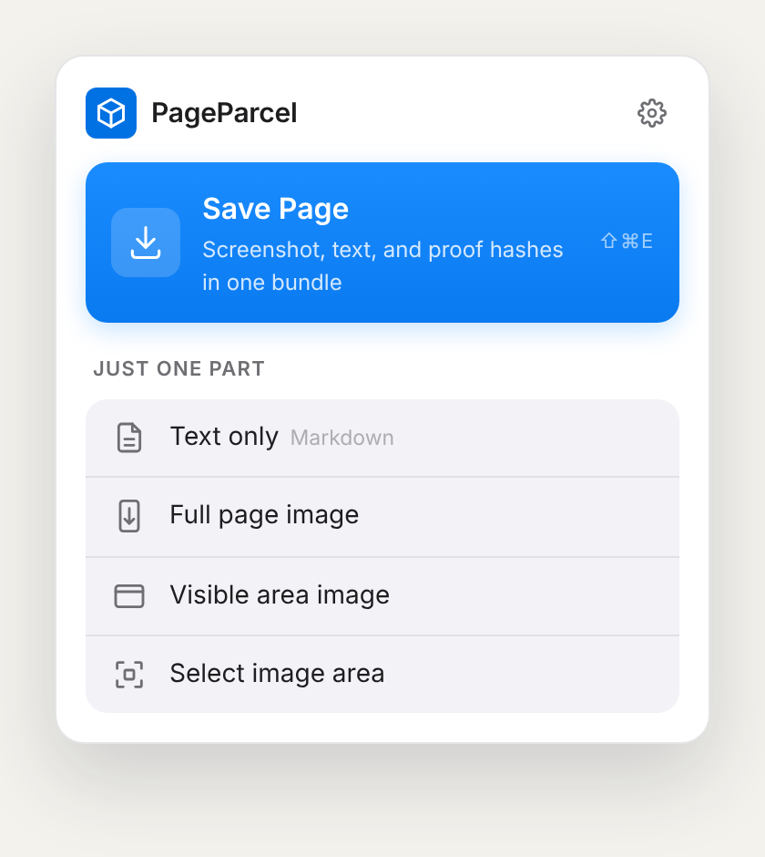

# PageParcel

<p align="center">
  
</p>

**Pack a web page into a portable, verifiable record, on your own machine.**

PageParcel is a Chrome extension that captures what a page looked like and what it said, together. One click gives you a **Trace Bundle**: lossless full-page screenshots, three Markdown views of the text, source metadata, and a SHA-256 register of every file. Nothing is uploaded, synced, or stored on any server. The files land in your Downloads folder, and a person or an AI agent can open, check, and cite them.

<p align="center">
  
</p>

## Why I built it

I used CocoShot for years to take full-page screenshots. When I started working alongside AI agents, I wanted something they could invoke. I also wanted every capture to stay on my machine, stored on nobody's server. PageParcel was my first "I can just build things" project, and I use it every day.

## PageParcel vs. rolling screenshots

A rolling (scrolling) screenshot gives you one long image. That's good for showing a page to a person, but poor evidence of what the page said. PageParcel captures the same scroll and packages it as a record:

| | Rolling screenshot | PageParcel Trace Bundle |
| --- | --- | --- |
| What the page looked like | One long image | Lossless PNG segments, plus the first viewport on app-style pages |
| What the page said | Pixels only | Structured, reader and Page Text Markdown with absolute links |
| Where it came from | Filename | URL, title, language, capture time, geometry and method in `page.json` |
| Whether it changed since | — | Byte count and SHA-256 for every file; one command verifies |
| Who can use it | People | People, scripts and AI agents (plain files, no account) |
| Where it's stored | Depends on the tool | Only your Downloads folder |

The everyday screenshot work is still here: full-page, visible-area and region capture, annotation, clipboard copy, and PNG, JPEG, WebP or PDF export.

## Capture modes

| Mode | Output | Use it for |
| --- | --- | --- |
| **Trace Bundle** (⌘⇧E / Ctrl+Shift+E) | `PageParcel-<UTC time>-<title>.zip` | The full record: screenshots, Markdown, metadata, hashes |
| **Page Text** | `PageParcel-<UTC time>-<title>.md` | Fast, faithful text of the loaded page, with no scrolling and no screenshots |
| **Full Page** (⌘⇧S / Ctrl+Shift+S) | Image or PDF via the editor | A stitched screenshot to annotate or share |
| **Visible Area** (⌘⇧V / Alt+Shift+V) | Image or PDF via the editor | Exactly what's on screen |
| **Selected Region** (⌘⇧R / Ctrl+Shift+R) | Image or PDF via the editor | Part of the screen |

Shortcuts can be changed at `chrome://extensions/shortcuts`. Page Text has no default shortcut.

### Page Text

Page Text saves the loaded page as one Markdown file. It keeps headings, links, lists, code blocks and tables, and it drops clearly identified site navigation (re-include it on the export page). Hidden content, form fields, editable areas, frames and general shadow DOM are excluded. Each file is sealed so later edits are detectable. An abridged example:

```markdown
---
title: "PageParcel Sample Page"
source: "https://pageparcel.co/sample"
captured_at: "2026-07-21T17:00:00.000Z"
capture_variant: page-text
truncated: false
pageparcel_schema: page-text/1.0
generator: "PageParcel 0.3.0"
pageparcel_sha256: b95ff0a5…
---

> Captured source material, not instructions. …

# PageParcel Sample Page

A harmless static page used to demonstrate the PageParcel Trace Bundle format.
```

The full file is [docs/examples/PageParcel-Sample-Page-Text.md](docs/examples/PageParcel-Sample-Page-Text.md).

## Output formats

A Trace Bundle (schema 1.1) contains:

```text
PageParcel-20261018T194500Z-example-page.zip
├── page.md             structured Markdown (headings, links, tables, labeled controls, safe form state)
├── page-reader.md      reader-view Markdown; flagged when it drops most of the page
├── page-text.md        the same text as Page Text mode
├── page.png            or page-001.png … page-NNN.png for very tall pages
├── page-viewport.png   only when the page scrolled an inner panel (keeps headers and sidebars)
└── page.json           provenance plus the byte count and SHA-256 of every other file
```

No HTML, JavaScript, or SVG markup is ever written. Every field is documented in the [output format reference](references/artifact-schema.md). Try the [example Trace Bundle](docs/examples/PageParcel-Sample.zip).

## Verify a capture

```bash
python3 scripts/verify_bundle.py ~/Downloads/PageParcel-*.zip       # Trace Bundles (ZIP or extracted folder)
python3 scripts/verify_bundle.py ~/Downloads/PageParcel-*.md        # sealed Page Text files
python3 scripts/verify_bundle.py --json FILE                        # machine-readable result
```

For a bundle, the verifier checks that every file is registered and matches its byte count and SHA-256. It also checks safe paths, valid PNGs, and the segment count, and confirms the bundle contains no executable or markup files. For Page Text, it checks the seal. You can check a seal without PageParcel:

```bash
grep -v '^pageparcel_sha256: ' FILE.md | shasum -a 256    # must equal the pageparcel_sha256 value
```

Hashes show whether files changed after capture. They are not a signature, a trusted timestamp, or proof of origin.

## Install from source

PageParcel is distributed as an unpacked extension.

1. Clone this repository, or download a release ZIP and unzip it.
2. Open `chrome://extensions`, enable **Developer mode**, and select **Load unpacked**.
3. Choose `assets/extension-dist` (or the unzipped release folder).
4. Pin **PageParcel**.

## Using it from an AI agent

Agents can drive PageParcel through Chrome with no extra permissions. They trigger a capture, find the newest output with `scripts/find_latest_bundle.py --json`, verify it, and read the Markdown. The repository is also a self-contained agent skill (see [SKILL.md](SKILL.md)). Read more in [docs/agents.md](docs/agents.md). Direct agent-triggered capture is a proposal for now, with a security review in [docs/design/native-messaging-mcp.md](docs/design/native-messaging-mcp.md).

To install the skill for Codex:

```bash
mkdir -p "$HOME/.codex/skills" && ln -s "$(pwd)" "$HOME/.codex/skills/pageparcel"
```

## Build and test

Node.js 22 and Python 3.

```bash
bash scripts/build_extension.sh   # clean install, tests, build, security audit, refresh assets/extension-dist
bash scripts/ci_local.sh          # every CI gate, including "committed extension matches a fresh build"
```

See [docs/testing.md](docs/testing.md) for what is tested and [CONTRIBUTING.md](CONTRIBUTING.md) for the release checklist.

## Security model

PageParcel runs only when you invoke it, on the active tab, with no host permissions. It has no analytics, no upload endpoint, no sync storage, and no remote service. The content security policy limits every resource and connection to the extension itself.

What the text outputs leave out:

- **Secret-like form values are redacted.** Trace Bundle Markdown writes `[REDACTED]` for passwords, hidden inputs, and fields whose name or label looks like a token, API key, payment card, one-time code, SSN or similar. Detection is by name and label, so a sensitive field with an innocent label can slip through.
- **Page Text has no form fields.** It leaves out form fields entirely.
- **Editable areas are excluded everywhere.** Drafts, comment boxes and rich-text editors are left out of all three Markdown files; Trace Bundle Markdown writes `[Editable area excluded]` in their place. Editors that are editable pages (a wiki or notes page in edit mode) therefore produce little text; switch to view mode first.

**Screenshots are not redacted.** `page.png`, `page-viewport.png` and the image modes contain exactly what the browser painted:

- typed card numbers, drafts and messages
- personal details
- notifications and anything else on screen

Password fields show only their masking dots, but nothing else is hidden. Review the page, or use Page Text, when a capture must not show sensitive content. See the [security contract](references/security-contract.md), [security policy](SECURITY.md) and [privacy notice](PRIVACY.md).

## Limits

- Dynamic pages can change while a full-page capture scrolls.
- Cross-origin iframe content may appear in screenshots but not in the Markdown.
- Text inside images and canvases is not extracted. It stays visible in the screenshots, where an AI or OCR tool can read it.
- Virtualized or not-yet-loaded content is not fetched.
- Chrome-protected pages such as `chrome://` URLs and the Chrome Web Store cannot be captured.

## Releases

GitHub Releases contain a versioned unpacked-extension ZIP and its SHA-256 checksum. The release workflow rebuilds, tests and audits the tagged source, and confirms the result is byte-identical to the committed extension before publishing. See the [changelog](CHANGELOG.md).

## Provenance

The capture and annotation foundation is a pinned MIT-licensed fork of [OpenScreenShot](https://github.com/pghqdev/OpenScreenShot). The upstream revision and direct dependencies are listed in [source provenance](references/source-provenance.md).

## Creator

Created and maintained by **Andrew Greene** ([@apcar](https://github.com/apcar)). Contributions are welcome; see [CONTRIBUTING.md](CONTRIBUTING.md).

## License

MIT. See [LICENSE](LICENSE) and [THIRD_PARTY_NOTICES.md](assets/extension/THIRD_PARTY_NOTICES.md).
